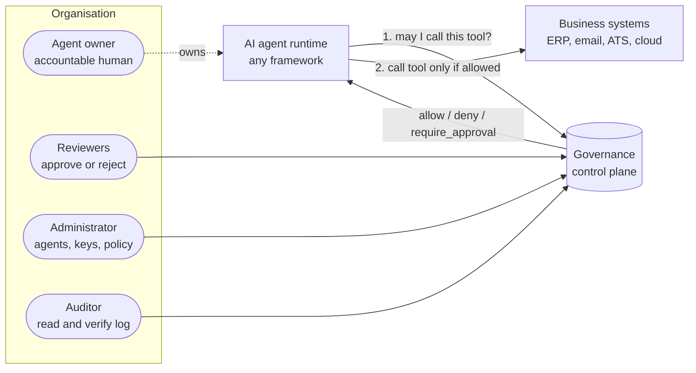
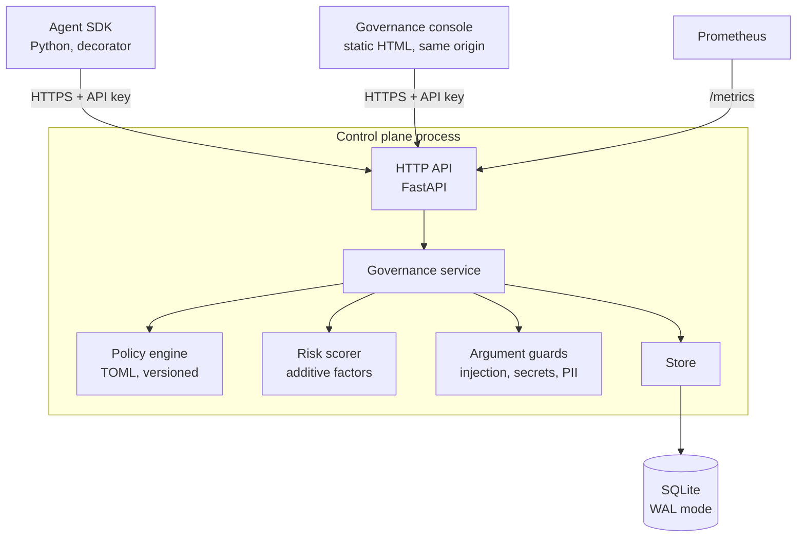
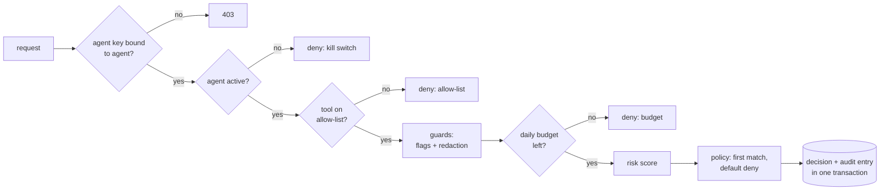
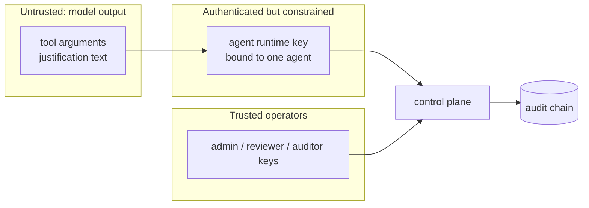

# Architecture

## Problem

AI agents now call tools that move money, send email, change records and grant access. Most
agent frameworks decide *how* to call a tool; few decide *whether* the call should happen,
who is accountable for it, and how anyone proves later what happened. The gaps that keep
appearing in practice are the ones OWASP lists as **LLM06:2025 Excessive Agency** and
**LLM01:2025 Prompt Injection**: agents with more permissions than their task needs, no human
in the loop for consequential actions, and no trustworthy record.

This platform is a **control plane**: agents ask before they act, and the answer is made by
policy, budgets and people, not by the model.

## System context (C4 level 1)



The control plane never calls business systems itself. It cannot be used to *do* anything,
only to *permit* things, which keeps its blast radius small (see ADR 0001).

## Containers (C4 level 2)



## Components and the decision pipeline



Steps B to G are **hard stops**: no policy can override them. Everything after is
configurable policy.

## Approval sequence

```mermaid
sequenceDiagram
    participant Ag as Agent (SDK)
    participant CP as Control plane
    participant R1 as Reviewer A
    participant R2 as Reviewer B
    Ag->>CP: POST /v1/decisions (payment 25,000)
    CP-->>Ag: require_approval (apr_…, 2 approvals, expires in 240 min)
    Note over Ag: SDK raises ApprovalPending;<br/>the agent tells the user and waits
    R1->>CP: vote approve + comment
    CP-->>R1: 1 of 2
    R2->>CP: vote approve + comment
    CP->>CP: re-check hard stops (budget, kill switch)
    CP-->>R2: approved
    Ag->>CP: GET /v1/decisions/dec_…
    CP-->>Ag: allow
    Ag->>Ag: call the tool
    Ag->>CP: POST /outcome executed
```

Separation of duties is enforced in the service: the agent's owner cannot approve, a
principal votes once, a comment is mandatory, and `admin`-only rules reject reviewers.

## Data model

| Table | Purpose |
|---|---|
| `principals` | humans and agent runtimes; API keys stored as SHA-256 hashes only |
| `agents` | registration: owner, purpose, autonomy, EU AI Act risk class, allow-list, budgets, status |
| `policies` | every policy version ever activated, with its hash and author |
| `decisions` | each request, its effect, status, risk factors and redacted arguments |
| `approvals` | pending and closed approvals with votes |
| `usage` | per-agent daily action and spend counters |
| `audit` | append-only, hash-chained event log |

Schema changes are versioned migrations (`PRAGMA user_version`).

## Trust boundaries



Arguments produced by a model are treated as untrusted data: they are inspected, redacted
and scored, never executed or interpreted as instructions by the control plane.

## Failure modes

| Failure | Behaviour |
|---|---|
| Control plane unreachable | SDK raises; the tool is **not** called (fail closed) |
| No policy loaded | `/readyz` returns 503 and decisions return 409 |
| Policy file invalid | rejected with 422; the previous version stays active |
| Approval not answered | expires and becomes deny |
| Budget used up while an approval waited | approval is converted to deny at approval time |
| Audit row edited or deleted | `/v1/audit/verify` reports the first broken entry |
| Database lost | restore from backup; the hash chain head lets you prove continuity |

## Scalability assumptions

The reference deployment is a single process with SQLite in WAL mode, which comfortably
serves the decision rate of tens of agents (each decision is one short write transaction).
For more, the store is the only module that touches SQL; move it to PostgreSQL, run several
API replicas behind a load balancer and keep the audit append in the same transaction as the
decision (ADR 0002). Rate limits per agent are enforced through daily budgets, not request
throttling; put a reverse proxy in front for network-level limits.
